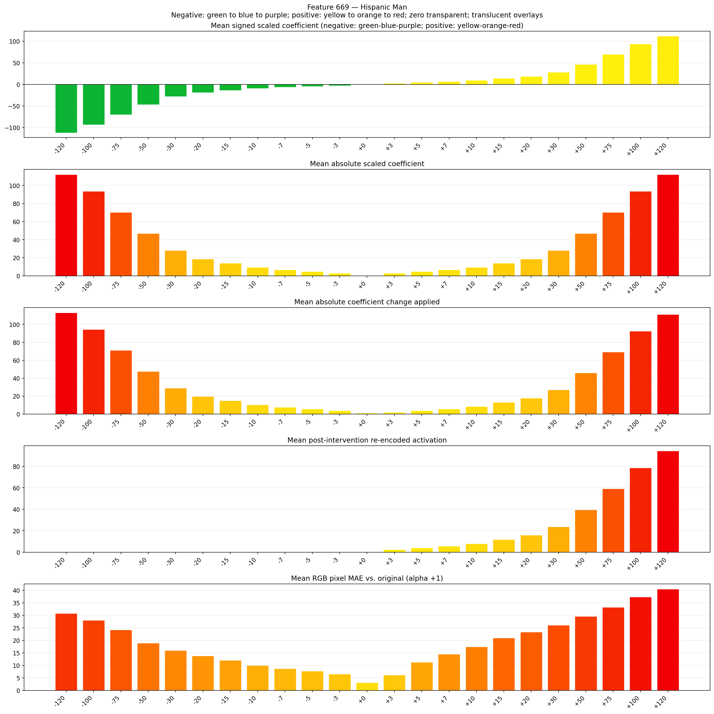
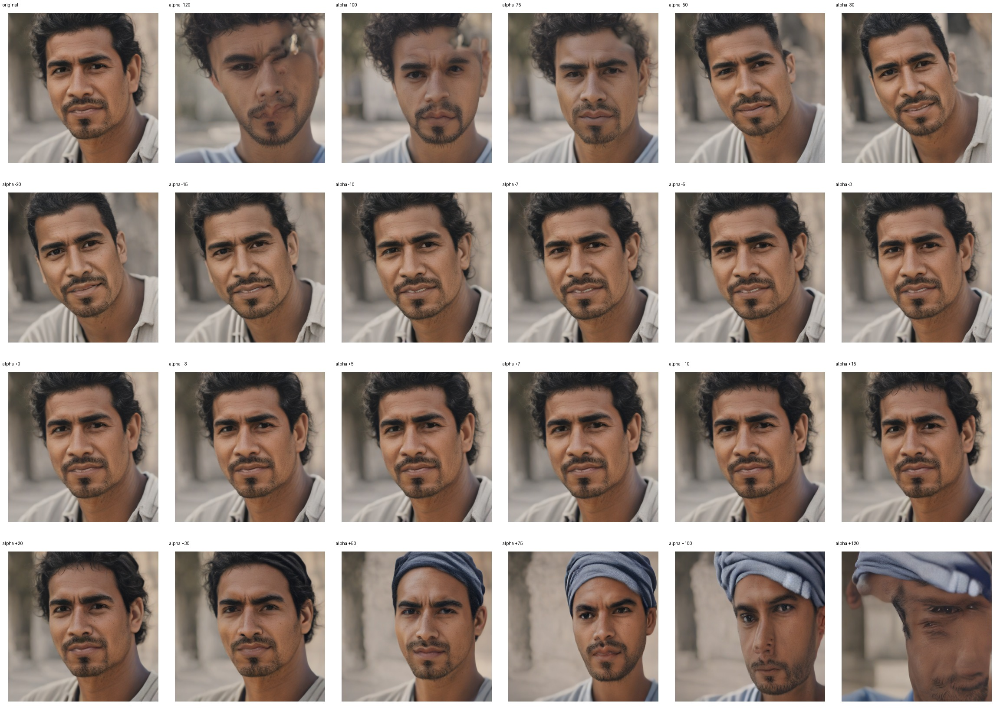
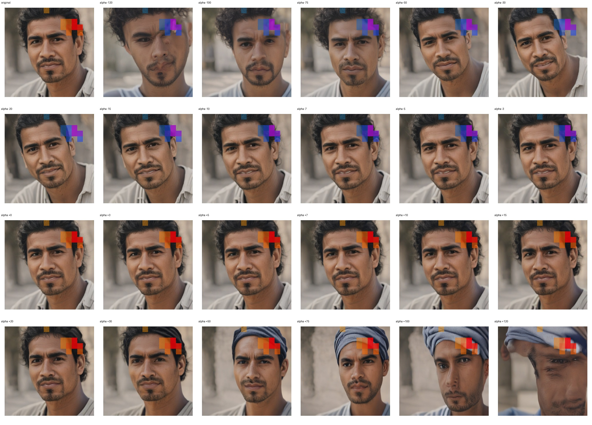
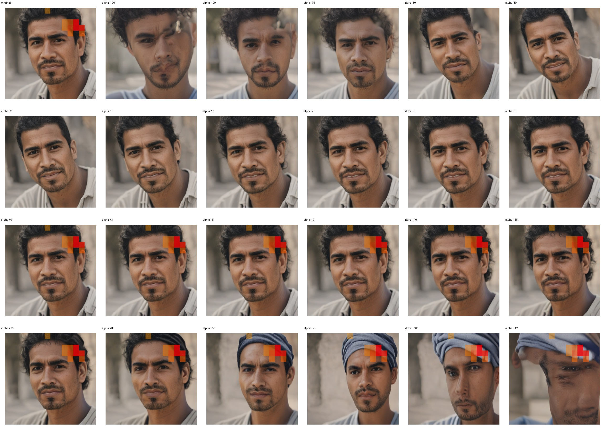

# Feature 669 — Hispanic Man

Biased dataset; original prompt and seed replay for seeds 0–19. Values are means across 20 source images. The table reports the mean post-re-encoded activation of feature 669, the active spatial fraction, mean RGB pixel MAE versus the original image (0–255 scale), and coefficient change magnitudes for each alpha.

## Activation graph

## Mean metrics by alpha

| Alpha | Mean post-reencoded feature 669 activation | Active spatial fraction | Mean pixel change (MAE) | Mean absolute coefficient change | Mean absolute scaled coefficient |
|---:|---:|---:|---:|---:|---:|
| -120 | 0.000 | 0.000 | 30.776 | 113.080 | 112.146 |
| -100 | 0.000 | 0.000 | 28.034 | 94.389 | 93.455 |
| -75 | 0.000 | 0.000 | 24.186 | 71.026 | 70.091 |
| -50 | 0.000 | 0.000 | 18.860 | 47.662 | 46.727 |
| -30 | 0.000 | 0.000 | 16.011 | 28.971 | 28.036 |
| -20 | 0.000 | 0.000 | 13.834 | 19.626 | 18.691 |
| -15 | 0.000 | 0.000 | 12.054 | 14.953 | 14.018 |
| -10 | 0.000 | 0.000 | 9.973 | 10.280 | 9.345 |
| -7 | 0.000 | 0.000 | 8.690 | 7.476 | 6.542 |
| -5 | 0.000 | 0.000 | 7.719 | 5.607 | 4.673 |
| -3 | 0.000 | 0.000 | 6.530 | 3.738 | 2.804 |
| +0 | 0.000 | 0.000 | 3.081 | 0.935 | 0.000 |
| +3 | 2.507 | 0.068 | 6.192 | 1.869 | 2.804 |
| +5 | 4.079 | 0.068 | 11.285 | 3.738 | 4.673 |
| +7 | 5.651 | 0.068 | 14.529 | 5.607 | 6.542 |
| +10 | 8.009 | 0.068 | 17.466 | 8.411 | 9.345 |
| +15 | 11.939 | 0.068 | 21.007 | 13.084 | 14.018 |
| +20 | 15.869 | 0.068 | 23.278 | 17.756 | 18.691 |
| +30 | 23.729 | 0.068 | 26.077 | 27.102 | 28.036 |
| +50 | 39.449 | 0.068 | 29.582 | 45.793 | 46.727 |
| +75 | 59.100 | 0.068 | 33.255 | 69.157 | 70.091 |
| +100 | 78.751 | 0.068 | 37.344 | 92.520 | 93.455 |
| +120 | 94.471 | 0.068 | 40.491 | 111.211 | 112.146 |

## Per-seed grids

Each 4×6 sheet contains the original followed by the 23 alpha variants in ascending alpha order, from −120 through +120.

### Plain images

[All 20 plain-image grids](seed_sheets/)

### Signed coefficient overlays

[All 20 signed coefficient grids](signed_coefficient_overlays/)

### Post-re-encoded activation overlays

[All 20 post-activation grids](post_activation_overlays/)

### Intervention-footprint overlays

[All 20 intervention-footprint grids](intervention_footprint_overlays/)

Zero is transparent. Negative coefficient colors progress green through blue to purple; positive colors progress yellow through orange to red. Each map tile is normalized individually for visibility. The original and alpha-zero tiles show the pre-intervention feature map so its location remains visible.
