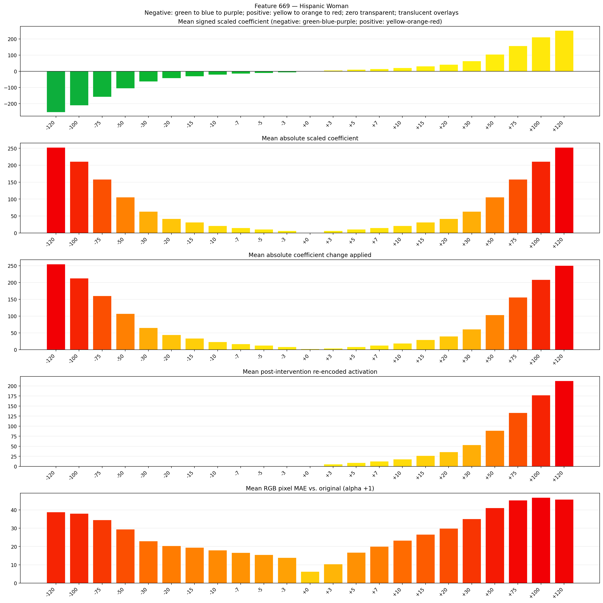
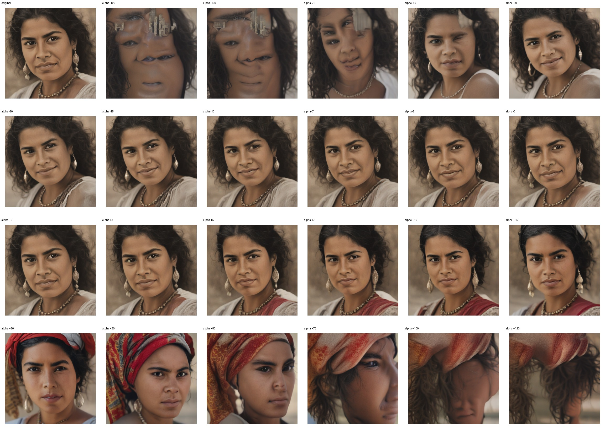
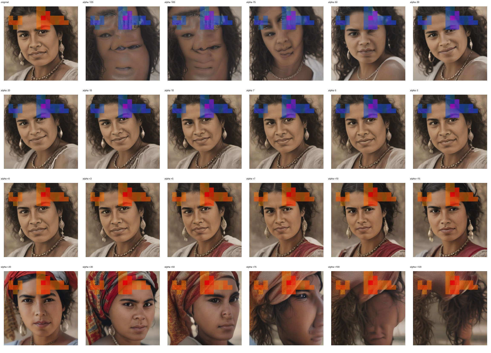
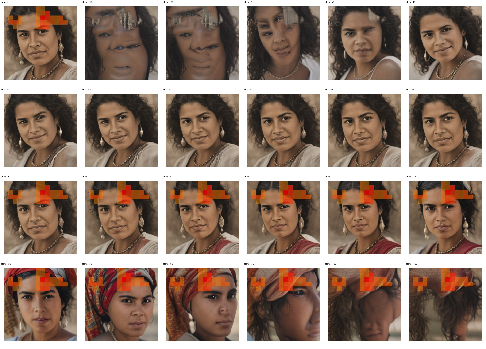

# Feature 669 — Hispanic Woman

Biased dataset; original prompt and seed replay for seeds 0–19. Values are means across 20 source images. The table reports the mean post-re-encoded activation of feature 669, the active spatial fraction, mean RGB pixel MAE versus the original image (0–255 scale), and coefficient change magnitudes for each alpha.

## Activation graph

## Mean metrics by alpha

| Alpha | Mean post-reencoded feature 669 activation | Active spatial fraction | Mean pixel change (MAE) | Mean absolute coefficient change | Mean absolute scaled coefficient |
|---:|---:|---:|---:|---:|---:|
| -120 | 0.000 | 0.000 | 38.906 | 254.973 | 252.866 |
| -100 | 0.000 | 0.000 | 38.113 | 212.829 | 210.721 |
| -75 | 0.000 | 0.000 | 34.540 | 160.148 | 158.041 |
| -50 | 0.000 | 0.000 | 29.392 | 107.468 | 105.361 |
| -30 | 0.000 | 0.000 | 23.013 | 65.324 | 63.216 |
| -20 | 0.000 | 0.000 | 20.386 | 44.251 | 42.144 |
| -15 | 0.000 | 0.000 | 19.475 | 33.715 | 31.608 |
| -10 | 0.000 | 0.000 | 18.000 | 23.179 | 21.072 |
| -7 | 0.000 | 0.000 | 16.653 | 16.858 | 14.750 |
| -5 | 0.000 | 0.000 | 15.454 | 12.643 | 10.536 |
| -3 | 0.000 | 0.000 | 13.916 | 8.429 | 6.322 |
| +0 | 0.000 | 0.000 | 6.352 | 2.107 | 0.000 |
| +3 | 5.652 | 0.117 | 10.440 | 4.214 | 6.322 |
| +5 | 9.196 | 0.117 | 16.696 | 8.429 | 10.536 |
| +7 | 12.741 | 0.117 | 20.094 | 12.643 | 14.750 |
| +10 | 18.058 | 0.117 | 23.285 | 18.965 | 21.072 |
| +15 | 26.920 | 0.117 | 26.635 | 29.501 | 31.608 |
| +20 | 35.781 | 0.117 | 29.909 | 40.037 | 42.144 |
| +30 | 53.504 | 0.117 | 35.105 | 61.109 | 63.216 |
| +50 | 88.950 | 0.117 | 41.070 | 103.253 | 105.361 |
| +75 | 133.258 | 0.117 | 45.256 | 155.934 | 158.041 |
| +100 | 177.566 | 0.117 | 46.797 | 208.614 | 210.721 |
| +120 | 213.012 | 0.117 | 45.821 | 250.758 | 252.866 |

## Per-seed grids

Each 4×6 sheet contains the original followed by the 23 alpha variants in ascending alpha order, from −120 through +120.

### Plain images

[All 20 plain-image grids](seed_sheets/)

### Signed coefficient overlays

[All 20 signed coefficient grids](signed_coefficient_overlays/)

### Post-re-encoded activation overlays

[All 20 post-activation grids](post_activation_overlays/)

### Intervention-footprint overlays

[All 20 intervention-footprint grids](intervention_footprint_overlays/)

Zero is transparent. Negative coefficient colors progress green through blue to purple; positive colors progress yellow through orange to red. Each map tile is normalized individually for visibility. The original and alpha-zero tiles show the pre-intervention feature map so its location remains visible.
