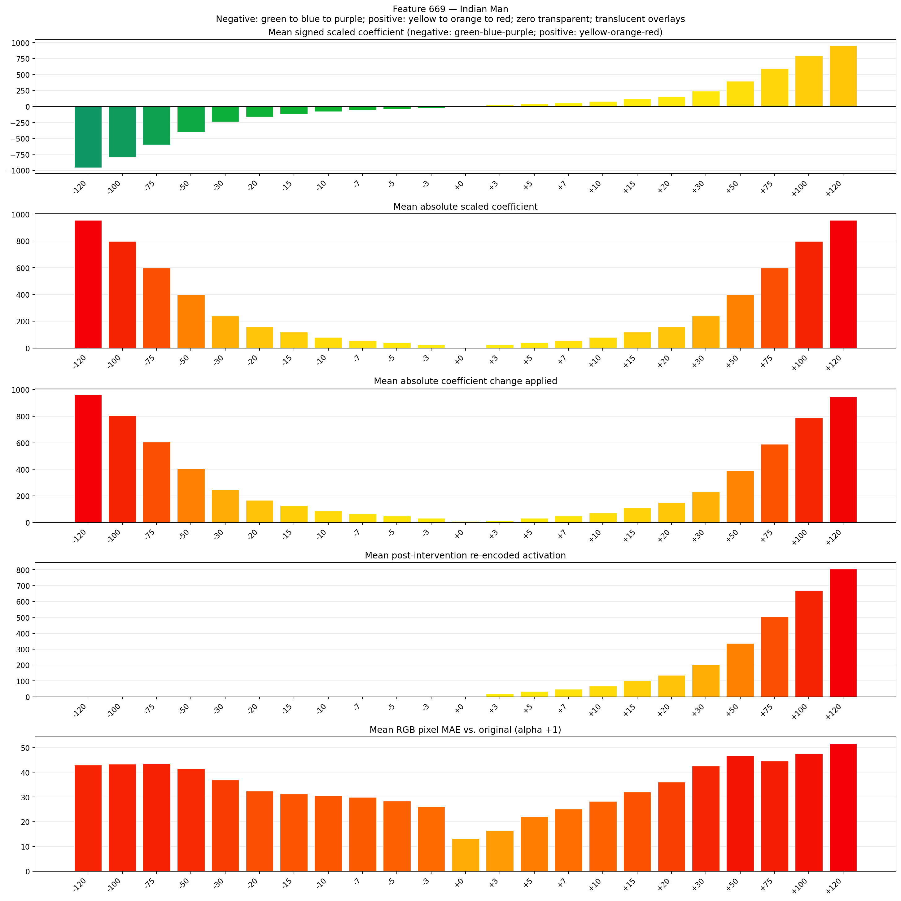
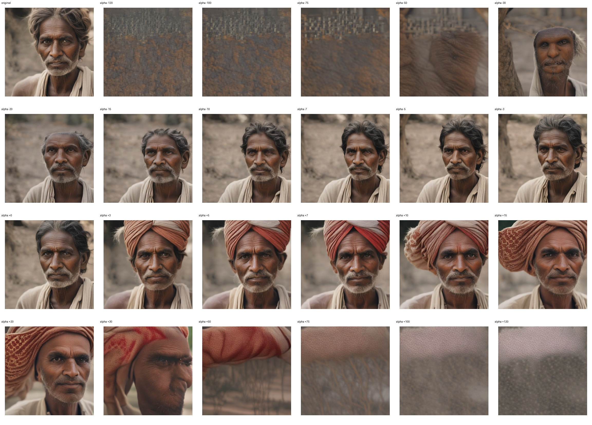
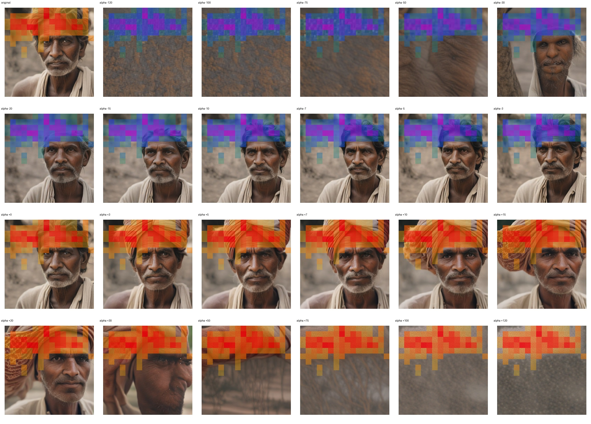
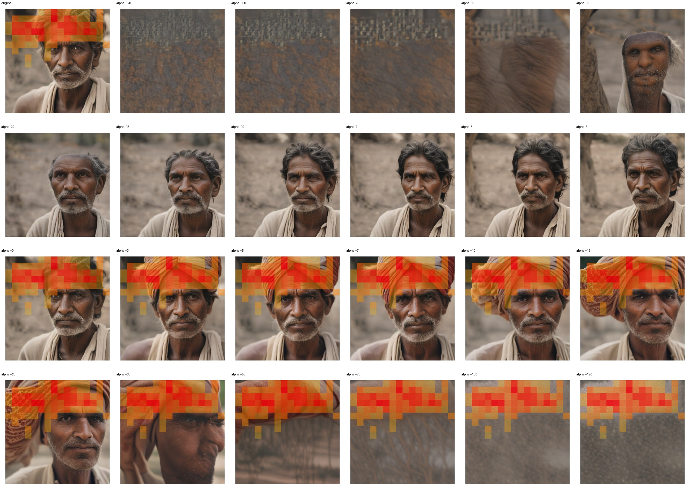

# Feature 669 — Indian Man

Biased dataset; original prompt and seed replay for seeds 0–19. Values are means across 20 source images. The table reports the mean post-re-encoded activation of feature 669, the active spatial fraction, mean RGB pixel MAE versus the original image (0–255 scale), and coefficient change magnitudes for each alpha.

## Activation graph

## Mean metrics by alpha

| Alpha | Mean post-reencoded feature 669 activation | Active spatial fraction | Mean pixel change (MAE) | Mean absolute coefficient change | Mean absolute scaled coefficient |
|---:|---:|---:|---:|---:|---:|
| -120 | 0.000 | 0.000 | 42.913 | 963.578 | 955.614 |
| -100 | 0.000 | 0.000 | 43.354 | 804.309 | 796.345 |
| -75 | 0.000 | 0.000 | 43.610 | 605.222 | 597.259 |
| -50 | 0.000 | 0.000 | 41.386 | 406.136 | 398.173 |
| -30 | 0.000 | 0.000 | 36.890 | 246.867 | 238.904 |
| -20 | 0.000 | 0.000 | 32.430 | 167.232 | 159.269 |
| -15 | 0.000 | 0.000 | 31.259 | 127.415 | 119.452 |
| -10 | 0.000 | 0.000 | 30.589 | 87.598 | 79.635 |
| -7 | 0.000 | 0.000 | 29.943 | 63.708 | 55.744 |
| -5 | 0.000 | 0.000 | 28.471 | 47.781 | 39.817 |
| -3 | 0.000 | 0.000 | 26.184 | 31.854 | 23.890 |
| +0 | 0.018 | 0.002 | 13.186 | 7.963 | 0.000 |
| +3 | 21.359 | 0.305 | 16.552 | 15.927 | 23.890 |
| +5 | 34.755 | 0.305 | 22.183 | 31.854 | 39.817 |
| +7 | 48.150 | 0.305 | 25.160 | 47.781 | 55.744 |
| +10 | 68.244 | 0.305 | 28.272 | 71.671 | 79.635 |
| +15 | 101.733 | 0.305 | 32.091 | 111.488 | 119.452 |
| +20 | 135.222 | 0.305 | 36.056 | 151.306 | 159.269 |
| +30 | 202.200 | 0.305 | 42.571 | 230.940 | 238.904 |
| +50 | 336.155 | 0.305 | 46.771 | 390.209 | 398.173 |
| +75 | 503.601 | 0.305 | 44.567 | 589.295 | 597.259 |
| +100 | 671.048 | 0.305 | 47.589 | 788.382 | 796.345 |
| +120 | 805.004 | 0.305 | 51.726 | 947.651 | 955.614 |

## Per-seed grids

Each 4×6 sheet contains the original followed by the 23 alpha variants in ascending alpha order, from −120 through +120.

### Plain images

[All 20 plain-image grids](seed_sheets/)

### Signed coefficient overlays

[All 20 signed coefficient grids](signed_coefficient_overlays/)

### Post-re-encoded activation overlays

[All 20 post-activation grids](post_activation_overlays/)

### Intervention-footprint overlays

[All 20 intervention-footprint grids](intervention_footprint_overlays/)

Zero is transparent. Negative coefficient colors progress green through blue to purple; positive colors progress yellow through orange to red. Each map tile is normalized individually for visibility. The original and alpha-zero tiles show the pre-intervention feature map so its location remains visible.
