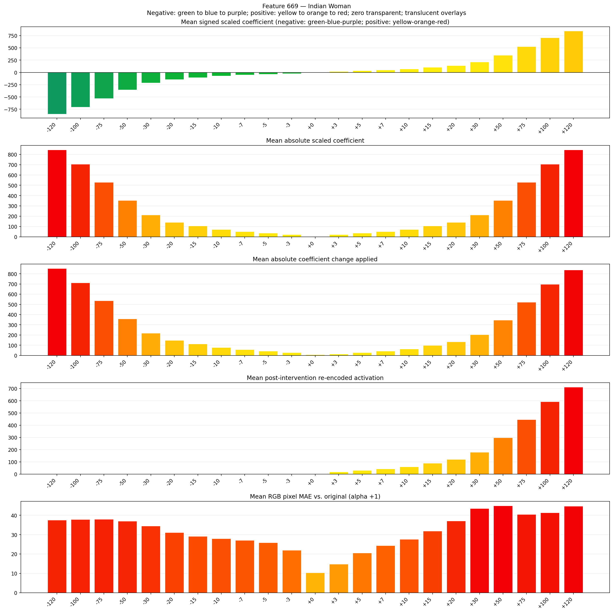
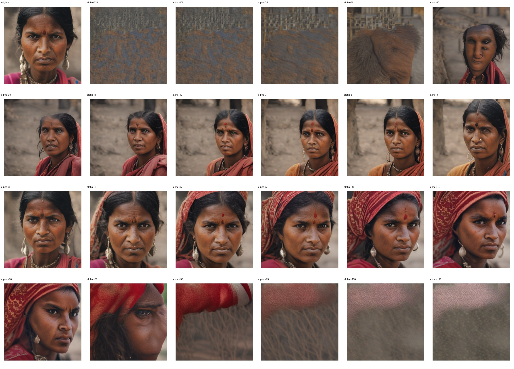
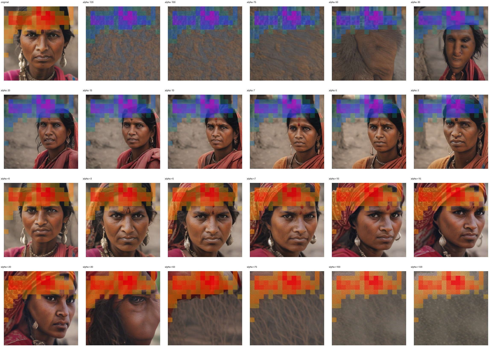
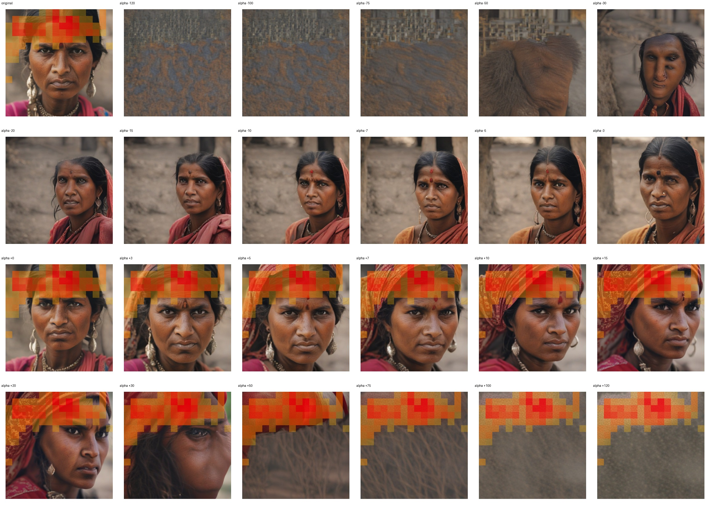

# Feature 669 — Indian Woman

Biased dataset; original prompt and seed replay for seeds 0–19. Values are means across 20 source images. The table reports the mean post-re-encoded activation of feature 669, the active spatial fraction, mean RGB pixel MAE versus the original image (0–255 scale), and coefficient change magnitudes for each alpha.

## Activation graph

## Mean metrics by alpha

| Alpha | Mean post-reencoded feature 669 activation | Active spatial fraction | Mean pixel change (MAE) | Mean absolute coefficient change | Mean absolute scaled coefficient |
|---:|---:|---:|---:|---:|---:|
| -120 | 0.000 | 0.000 | 37.576 | 852.724 | 845.677 |
| -100 | 0.000 | 0.000 | 37.804 | 711.778 | 704.730 |
| -75 | 0.000 | 0.000 | 37.955 | 535.595 | 528.548 |
| -50 | 0.000 | 0.000 | 36.991 | 359.413 | 352.365 |
| -30 | 0.000 | 0.000 | 34.430 | 218.466 | 211.419 |
| -20 | 0.000 | 0.000 | 31.139 | 147.993 | 140.946 |
| -15 | 0.000 | 0.000 | 29.182 | 112.757 | 105.710 |
| -10 | 0.000 | 0.000 | 27.997 | 77.520 | 70.473 |
| -7 | 0.000 | 0.000 | 27.058 | 56.378 | 49.331 |
| -5 | 0.000 | 0.000 | 25.831 | 42.284 | 35.237 |
| -3 | 0.000 | 0.000 | 21.955 | 28.189 | 21.142 |
| +0 | 0.045 | 0.005 | 10.280 | 7.047 | 0.000 |
| +3 | 18.902 | 0.254 | 14.811 | 14.095 | 21.142 |
| +5 | 30.756 | 0.254 | 20.524 | 28.189 | 35.237 |
| +7 | 42.611 | 0.254 | 24.369 | 42.284 | 49.331 |
| +10 | 60.393 | 0.254 | 27.632 | 63.426 | 70.473 |
| +15 | 90.029 | 0.254 | 31.901 | 98.662 | 105.710 |
| +20 | 119.665 | 0.254 | 37.069 | 133.899 | 140.946 |
| +30 | 178.938 | 0.254 | 43.538 | 204.372 | 211.419 |
| +50 | 297.484 | 0.254 | 44.945 | 345.318 | 352.365 |
| +75 | 445.665 | 0.254 | 40.479 | 521.501 | 528.548 |
| +100 | 593.846 | 0.254 | 41.301 | 697.683 | 704.730 |
| +120 | 712.392 | 0.254 | 44.710 | 838.629 | 845.677 |

## Per-seed grids

Each 4×6 sheet contains the original followed by the 23 alpha variants in ascending alpha order, from −120 through +120.

### Plain images

[All 20 plain-image grids](seed_sheets/)

### Signed coefficient overlays

[All 20 signed coefficient grids](signed_coefficient_overlays/)

### Post-re-encoded activation overlays

[All 20 post-activation grids](post_activation_overlays/)

### Intervention-footprint overlays

[All 20 intervention-footprint grids](intervention_footprint_overlays/)

Zero is transparent. Negative coefficient colors progress green through blue to purple; positive colors progress yellow through orange to red. Each map tile is normalized individually for visibility. The original and alpha-zero tiles show the pre-intervention feature map so its location remains visible.
