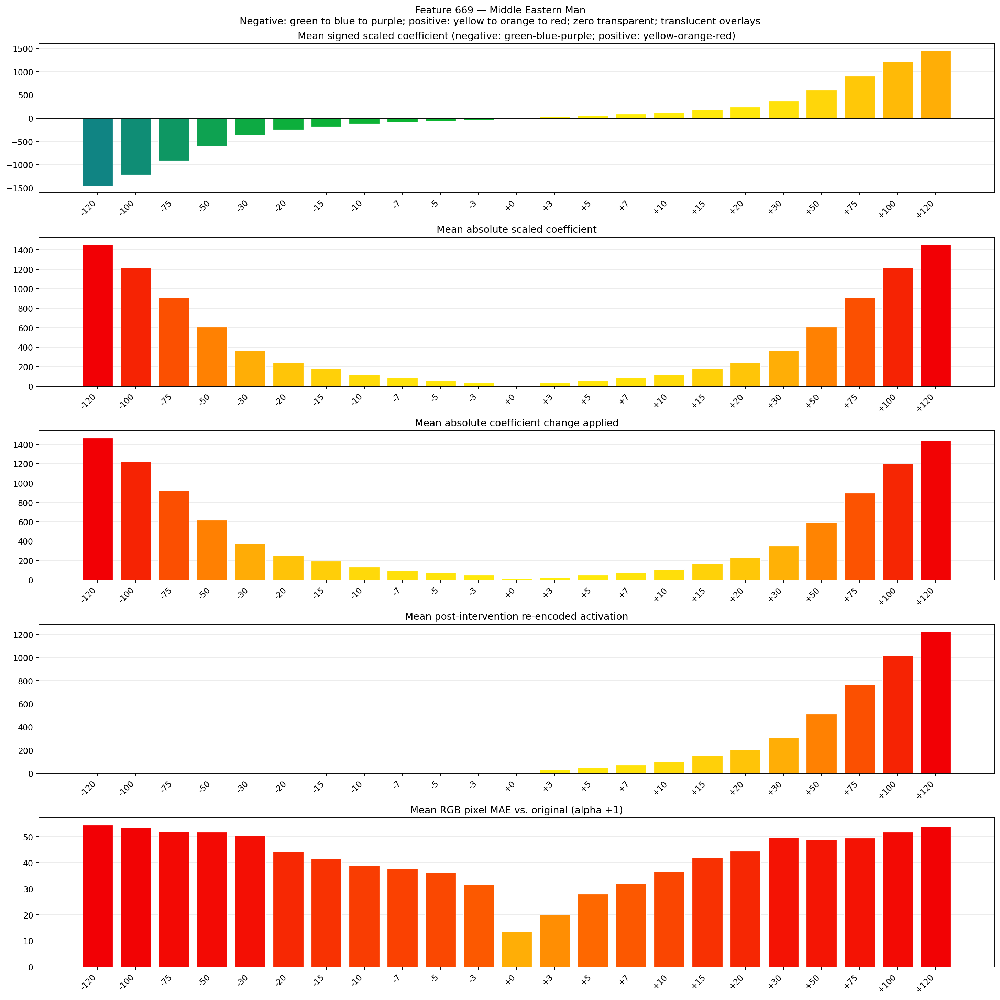
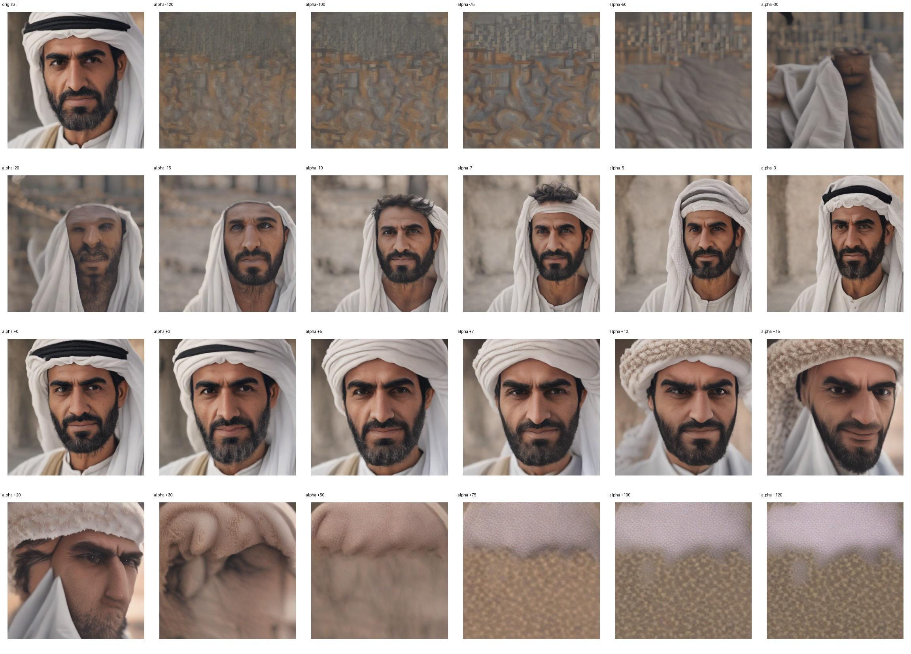
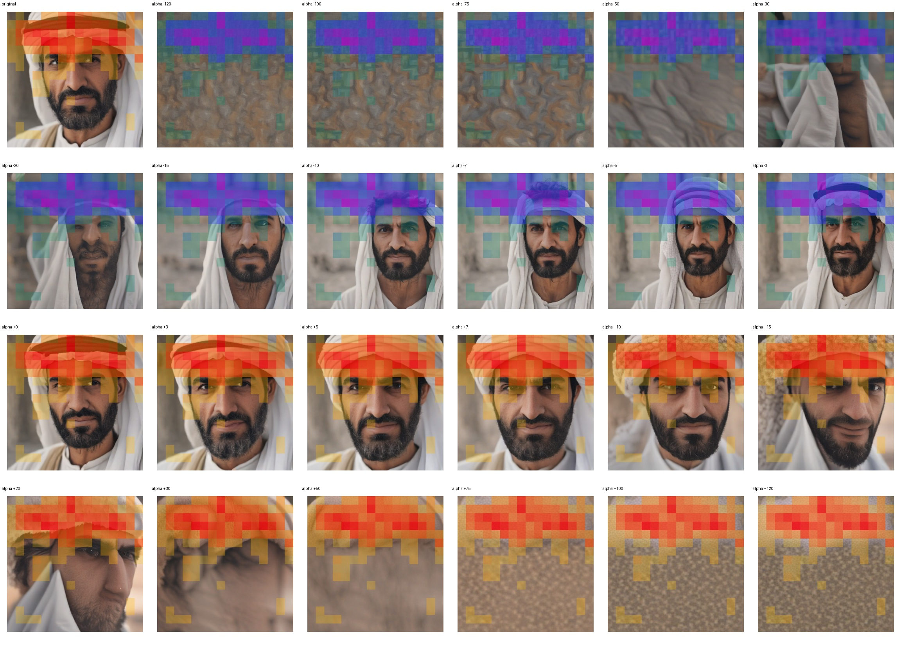
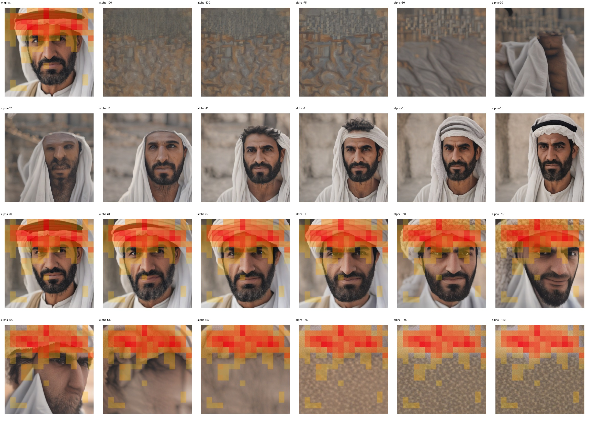

# Feature 669 — Middle Eastern Man

Biased dataset; original prompt and seed replay for seeds 0–19. Values are means across 20 source images. The table reports the mean post-re-encoded activation of feature 669, the active spatial fraction, mean RGB pixel MAE versus the original image (0–255 scale), and coefficient change magnitudes for each alpha.

## Activation graph

## Mean metrics by alpha

| Alpha | Mean post-reencoded feature 669 activation | Active spatial fraction | Mean pixel change (MAE) | Mean absolute coefficient change | Mean absolute scaled coefficient |
|---:|---:|---:|---:|---:|---:|
| -120 | 0.000 | 0.000 | 54.561 | 1468.034 | 1455.901 |
| -100 | 0.000 | 0.000 | 53.552 | 1225.384 | 1213.251 |
| -75 | 0.000 | 0.000 | 52.211 | 922.071 | 909.938 |
| -50 | 0.000 | 0.000 | 51.966 | 618.758 | 606.626 |
| -30 | 0.000 | 0.000 | 50.640 | 376.108 | 363.975 |
| -20 | 0.000 | 0.000 | 44.361 | 254.783 | 242.650 |
| -15 | 0.000 | 0.000 | 41.704 | 194.120 | 181.988 |
| -10 | 0.000 | 0.000 | 39.022 | 133.458 | 121.325 |
| -7 | 0.000 | 0.000 | 37.834 | 97.060 | 84.928 |
| -5 | 0.000 | 0.000 | 36.187 | 72.795 | 60.663 |
| -3 | 0.000 | 0.000 | 31.696 | 48.530 | 36.398 |
| +0 | 0.433 | 0.055 | 13.716 | 12.133 | 0.000 |
| +3 | 32.541 | 0.454 | 20.053 | 24.265 | 36.398 |
| +5 | 52.950 | 0.454 | 27.948 | 48.530 | 60.663 |
| +7 | 73.358 | 0.454 | 32.128 | 72.795 | 84.928 |
| +10 | 103.971 | 0.454 | 36.588 | 109.193 | 121.325 |
| +15 | 154.992 | 0.454 | 41.953 | 169.855 | 181.988 |
| +20 | 206.014 | 0.454 | 44.531 | 230.518 | 242.650 |
| +30 | 308.057 | 0.454 | 49.695 | 351.843 | 363.975 |
| +50 | 512.142 | 0.454 | 49.028 | 594.493 | 606.626 |
| +75 | 767.250 | 0.454 | 49.466 | 897.806 | 909.938 |
| +100 | 1022.356 | 0.454 | 51.963 | 1201.119 | 1213.251 |
| +120 | 1226.441 | 0.454 | 53.992 | 1443.769 | 1455.901 |

## Per-seed grids

Each 4×6 sheet contains the original followed by the 23 alpha variants in ascending alpha order, from −120 through +120.

### Plain images

[All 20 plain-image grids](seed_sheets/)

### Signed coefficient overlays

[All 20 signed coefficient grids](signed_coefficient_overlays/)

### Post-re-encoded activation overlays

[All 20 post-activation grids](post_activation_overlays/)

### Intervention-footprint overlays

[All 20 intervention-footprint grids](intervention_footprint_overlays/)

Zero is transparent. Negative coefficient colors progress green through blue to purple; positive colors progress yellow through orange to red. Each map tile is normalized individually for visibility. The original and alpha-zero tiles show the pre-intervention feature map so its location remains visible.
