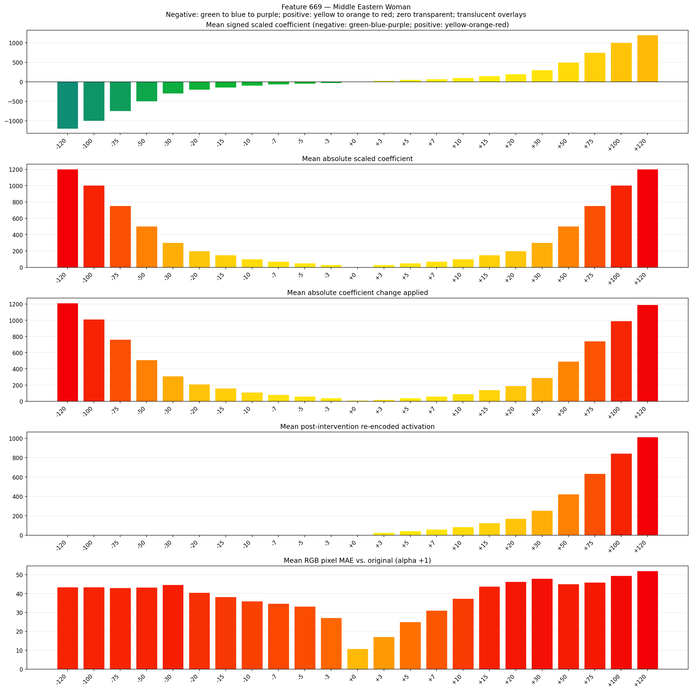
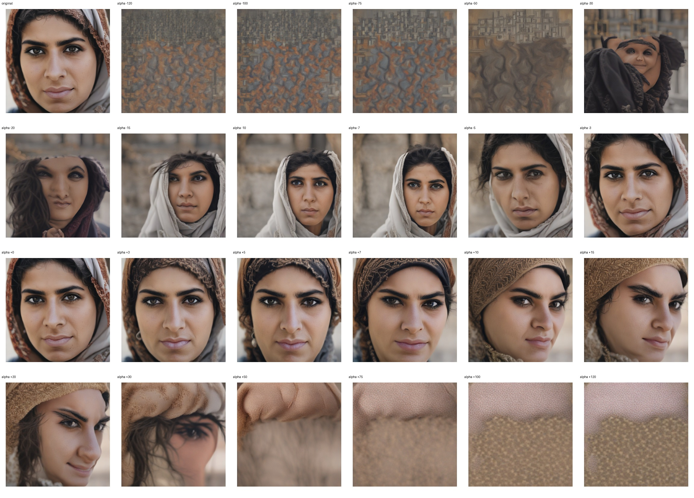
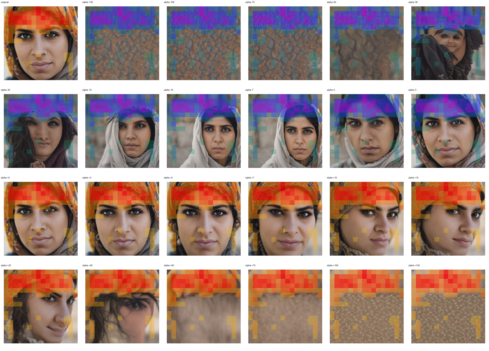
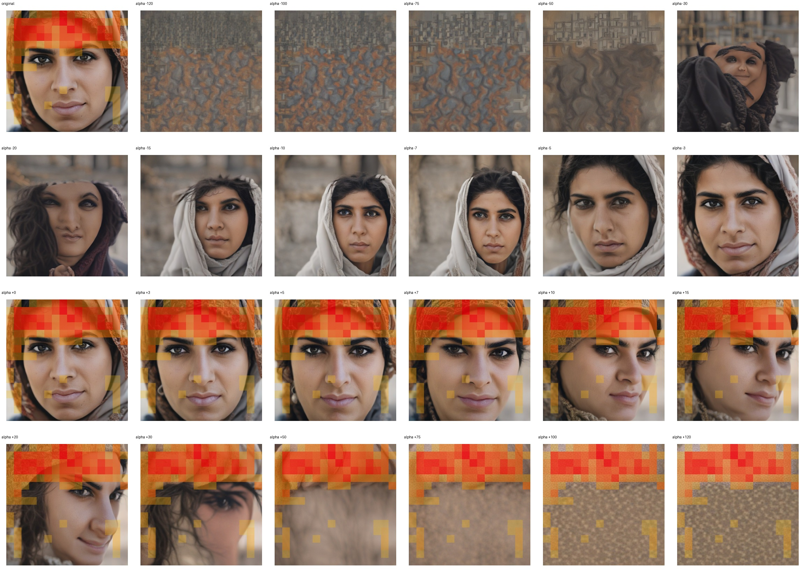

# Feature 669 — Middle Eastern Woman

Biased dataset; original prompt and seed replay for seeds 0–19. Values are means across 20 source images. The table reports the mean post-re-encoded activation of feature 669, the active spatial fraction, mean RGB pixel MAE versus the original image (0–255 scale), and coefficient change magnitudes for each alpha.

## Activation graph

## Mean metrics by alpha

| Alpha | Mean post-reencoded feature 669 activation | Active spatial fraction | Mean pixel change (MAE) | Mean absolute coefficient change | Mean absolute scaled coefficient |
|---:|---:|---:|---:|---:|---:|
| -120 | 0.000 | 0.000 | 43.439 | 1212.890 | 1202.866 |
| -100 | 0.000 | 0.000 | 43.387 | 1012.412 | 1002.388 |
| -75 | 0.000 | 0.000 | 43.099 | 761.815 | 751.791 |
| -50 | 0.000 | 0.000 | 43.264 | 511.218 | 501.194 |
| -30 | 0.000 | 0.000 | 44.687 | 310.740 | 300.716 |
| -20 | 0.000 | 0.000 | 40.557 | 210.502 | 200.478 |
| -15 | 0.000 | 0.000 | 38.308 | 160.382 | 150.358 |
| -10 | 0.000 | 0.000 | 36.010 | 110.263 | 100.239 |
| -7 | 0.000 | 0.000 | 34.746 | 80.191 | 70.167 |
| -5 | 0.000 | 0.000 | 33.283 | 60.143 | 50.119 |
| -3 | 0.000 | 0.000 | 27.199 | 40.096 | 30.072 |
| +0 | 0.347 | 0.048 | 10.851 | 10.024 | 0.000 |
| +3 | 26.885 | 0.417 | 17.114 | 20.048 | 30.072 |
| +5 | 43.747 | 0.417 | 25.051 | 40.096 | 50.119 |
| +7 | 60.609 | 0.417 | 31.062 | 60.143 | 70.167 |
| +10 | 85.901 | 0.417 | 37.458 | 90.215 | 100.239 |
| +15 | 128.055 | 0.417 | 43.857 | 140.334 | 150.358 |
| +20 | 170.209 | 0.417 | 46.369 | 190.454 | 200.478 |
| +30 | 254.516 | 0.417 | 47.931 | 290.693 | 300.716 |
| +50 | 423.132 | 0.417 | 45.093 | 491.170 | 501.194 |
| +75 | 633.902 | 0.417 | 46.028 | 741.767 | 751.791 |
| +100 | 844.672 | 0.417 | 49.503 | 992.364 | 1002.388 |
| +120 | 1013.287 | 0.417 | 52.027 | 1192.842 | 1202.866 |

## Per-seed grids

Each 4×6 sheet contains the original followed by the 23 alpha variants in ascending alpha order, from −120 through +120.

### Plain images

[All 20 plain-image grids](seed_sheets/)

### Signed coefficient overlays

[All 20 signed coefficient grids](signed_coefficient_overlays/)

### Post-re-encoded activation overlays

[All 20 post-activation grids](post_activation_overlays/)

### Intervention-footprint overlays

[All 20 intervention-footprint grids](intervention_footprint_overlays/)

Zero is transparent. Negative coefficient colors progress green through blue to purple; positive colors progress yellow through orange to red. Each map tile is normalized individually for visibility. The original and alpha-zero tiles show the pre-intervention feature map so its location remains visible.
